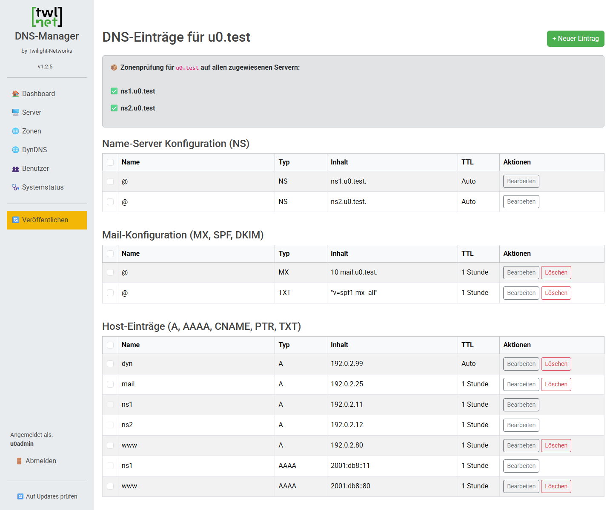
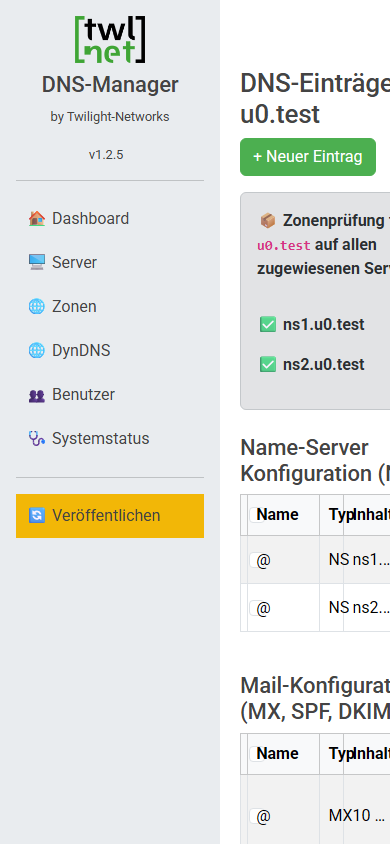

# UI-Modernisierung U0 – Bestandsaufnahme der Oberfläche

Stand: 14.11.2026. Ist-Zustand der Weboberfläche von `main` `1e37515` (Version 1.2.5) als Ausgangspunkt für U1–U6.
Regeln: [`docs/UI_GUIDELINES.md`](../UI_GUIDELINES.md) · Rollen: [`docs/UI_ROLE_MATRIX.md`](../UI_ROLE_MATRIX.md) ·
Regressionsbasis: [`tests/ui/README.md`](../../tests/ui/README.md).

## 1. Überblick

| Bereich | Ist-Zustand |
|---|---|
| Technik | Serverseitiges PHP. Bootstrap 5.3.3 und Roboto lokal, Vanilla-JS (15 Dateien), `custom.css` (294 Zeilen), `AssetRegistry`. Kein Build-Schritt. |
| Umfang | 8 Seiten (1 755 Zeilen), 12 Templates (1 721), 20 Actions (2 761), Login/Logout, DynDNS-API. |
| Datenzugriff | Seiten lesen über die Core-Read-Services. Änderungen laufen nur über Actions → Core-Services. |
| Layout | Feste Seitenleiste mit 220 px und Emoji-Symbolen. **Kein `viewport`-Meta, keine Media Queries.** Kein Dark Mode. |
| Bearbeitung | Zonen/Records inline in der Tabellenzeile (`?edit_id=`, `?add_new=1`). Benutzer, Server und DynDNS: Anlage/Bearbeitung serverseitig über `?add_new=1`/`?edit_id=`; Passwort, Deaktivierung und BIND-Reload nur per Modal (U0-B8). Löschen über `form.confirm-delete` mit globalem Bestätigungs-Modal. |
| Listen | Keine Suche, Filterung, Sortierung oder Paginierung. |
| CSP-Hindernisse | Ein Inline-Skript (komplettes `$LANG` als `window.LANG` auf jeder Seite), 10 Inline-Handler, 35 `style=`-Attribute. |
| Barrierefreiheit | 124 `<label>`, davon 34 mit `for=`; 25 `aria-`-Attribute. |
| Sprachen | `de`/`en`/`es` mit je 430 Schlüsseln. F2 (fehlende Schlüssel) ist offen. |

## 2. Screenshots des Ist-Zustands

Erzeugt aus der isolierten Testkopie (Fixture der Golden-Basis) mit `tests/ui/run.sh serve` und
`tests/ui/screenshots.ps1`:
- Microsoft Edge 157 headless;
- Desktop 1440 px, mobil 390 × 844 px;
- Harness `21ca9e3`.

Ablage: [`docs/ui/screenshots/u0/`](screenshots/u0/).

### Desktop – admin

| Seite | Screenshot |
|---|---|
| Dashboard | [admin-dashboard.png](screenshots/u0/admin-dashboard.png) |
| Zonen / Anlage / Bearbeitung | [admin-zones.png](screenshots/u0/admin-zones.png) · [admin-zones-add.png](screenshots/u0/admin-zones-add.png) · [admin-zones-edit.png](screenshots/u0/admin-zones-edit.png) |
| Records / Anlage / Bearbeitung / Reverse | [admin-records.png](screenshots/u0/admin-records.png) · [admin-records-add.png](screenshots/u0/admin-records-add.png) · [admin-records-edit.png](screenshots/u0/admin-records-edit.png) · [admin-records-reverse.png](screenshots/u0/admin-records-reverse.png) |
| Server / Anlage / Bearbeitung | [admin-servers.png](screenshots/u0/admin-servers.png) · [admin-servers-add.png](screenshots/u0/admin-servers-add.png) · [admin-servers-edit.png](screenshots/u0/admin-servers-edit.png) |
| DynDNS / Anlage | [admin-dyndns.png](screenshots/u0/admin-dyndns.png) · [admin-dyndns-add.png](screenshots/u0/admin-dyndns-add.png) |
| Benutzer / Anlage | [admin-users.png](screenshots/u0/admin-users.png) · [admin-users-add.png](screenshots/u0/admin-users-add.png) |
| Systemstatus | [admin-system-health.png](screenshots/u0/admin-system-health.png) |
| Update-Seite | [admin-update.png](screenshots/u0/admin-update.png) |

### Desktop – zoneadmin und anonym

| Seite | Screenshot |
|---|---|
| Anmeldung | [anon-login-desktop.png](screenshots/u0/anon-login-desktop.png) |
| zoneadmin: Dashboard / Zonen / Records / Benutzer | [zoneadmin-dashboard.png](screenshots/u0/zoneadmin-dashboard.png) · [zoneadmin-zones.png](screenshots/u0/zoneadmin-zones.png) · [zoneadmin-records.png](screenshots/u0/zoneadmin-records.png) · [zoneadmin-users.png](screenshots/u0/zoneadmin-users.png) |
| 403 (z. B. zoneadmin auf Server) | kein Screenshot: reine Textantwort „Zugriff verweigert: Unzureichende Berechtigungen.“ ohne Layout (U0-B6); belegt in der Rollenmatrix |

### Mobil (390 px)

| Seite | Screenshot |
|---|---|
| Anmeldung / Dashboard / Zonen / Records | [anon-login-mobile.png](screenshots/u0/anon-login-mobile.png) · [admin-dashboard-mobile.png](screenshots/u0/admin-dashboard-mobile.png) · [admin-zones-mobile.png](screenshots/u0/admin-zones-mobile.png) · [admin-records-mobile.png](screenshots/u0/admin-records-mobile.png) |

## 3. Befunde aus U0

Alle Befunde sind **vorbestehend** (Stand `1e37515`). Sie sind in der Golden-Basis festgehalten und werden im
genannten Paket behoben; die Behebung erscheint im Vergleich als freigegebene Abweichung mit Fall-ID.

| ID | Befund | Nachweis | Paket |
|---|---|---|---|
| U0-B1 | **TXT-Record ohne JavaScript nicht anlegbar.** `record_add_form.php` enthält immer das versteckte Feld `is_dkim=1`; erst `record_add_form.js` entfernt es bei Nicht-DKIM-Einträgen. Ohne JS wird jeder TXT als DKIM geprüft und abgelehnt. | Fälle `record/add_admin_txt` (mit nachgebildetem JS: Erfolg) und `record/add_admin_txt_ohne_js` (drei DKIM-Fehler) | U4 (Rückfall nach Leitfaden 3) |
| U0-B2 | **PHP-8.5-Deprecation in `pages/records.php:225`:** `htmlspecialchars()` erhält `null`, wenn eine Diagnose ohne Meldungstext (`diagnostics.message` NULL) angezeigt wird. 14 Meldungen in 9 Seitenfällen. | Feld `problems` der Seitenfälle `records_*` | U4 |
| U0-B3 | **F2 bestätigt:** `Undefined array key "zone_prefix_placeholder"` in `templates/zone_add_form.php:70`. | Seitenfall `page/admin/zones_add` | U5 (F2) |
| U0-B4 | **Formular ohne Berechtigung angezeigt:** zoneadmin erhält auf `users.php?edit_id=<eigene ID>` das Formular `user_update`; die Action ist admin-only (403). | Seitenvertrag `page/zoneadmin/users_edit2` | U5 |
| U0-B5 | **Nicht responsiv:** kein `viewport`-Meta, feste Seitenleiste; auf 390 px wird der Inhalt abgeschnitten. | Mobil-Screenshots | U1 |
| U0-B6 | **403 ohne Layout:** `requireRole()` antwortet mit reinem Text, ohne Navigation zurück. | Rollenmatrix | U1/U3 (Status bleibt 403) |
| U0-B7 | zoneadmin löscht Record einer fremden Zone: 302 mit allgemeiner Fehlermeldung statt 403. Zugriff korrekt verweigert. | Fall `record/delete_zoneadmin_foreign` | keiner (Web-Vertrag bleibt) |
| U0-B8 | **Nur per JavaScript erreichbar:** Passwortänderung (Benutzer und DynDNS), Kontodeaktivierung und BIND-Reload. Die Formulare stehen in Bootstrap-Modals (`pwModal…`, `disableModal…`, `reloadConfirmModal`), die ohne JS unsichtbar bleiben. Die Actions selbst funktionieren (direkt gesendete Fälle in der Basis). | Code (`pages/users.php`, `pages/dyndns.php`, `pages/servers.php`); Fälle `user/password_*`, `user/set_inactive_admin`, `dyndns/password_*`, `server/bind_reload_admin` | U3/U5 (Rückfall nach Leitfaden 3) |
| U0-B9 | **Löschen ohne JS ohne Bestätigung:** Formulare `confirm-delete` werden ohne JS sofort abgesendet; die Bestätigung kommt nur aus `global.js`. | Code (`assets/js/global.js`, Lösch-Formulare) | U3 |

Korrektur zum Konzept (1. Bestandsaufnahme): Benutzer, Server und DynDNS nutzen Modals nur für Passwort,
Deaktivierung und Reload-Bestätigung; Anlage und Bearbeitung laufen dort bereits serverseitig über `?add_new=1`/`?edit_id=`.

**Hinweis Werkzeug:** Edge headless beendet sich bei einer 403-Textantwort nicht selbst. `screenshots.ps1` begrenzt
deshalb jede Aufnahme zeitlich; 403-Seiten werden nicht fotografiert.

## 4. Einordnung für die Pakete

- **U1 (Layout):** U0-B5, Teile von U0-B6. Die Golden-Basis meldet Layoutänderungen nur informativ. Seitenvertrag (Formulare/Links) und Zugriffsschutz müssen gleich bleiben.
- **U2 (CSP):** Inline-Skript `window.LANG`, 10 Handler, 35 `style=`. Danach Report-Only nach Leitfaden 4.
- **U3 (Bausteine):** Bestätigungs- und Modal-Muster mit serverseitigem Rückfall (U0-B8, U0-B9), einheitliche Fehlerseite (U0-B6).
- **U4 (Zonen/Records):** U0-B1, U0-B2.
- **U5:** U0-B3 (F2), U0-B4, Rückfälle der Passwort-/Deaktivierungs-/Reload-Dialoge (U0-B8), F5, F8.
